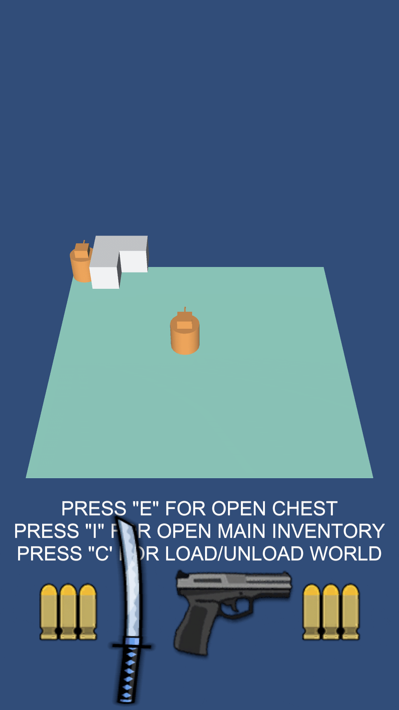
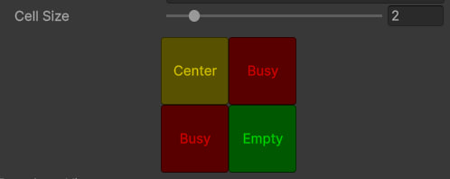
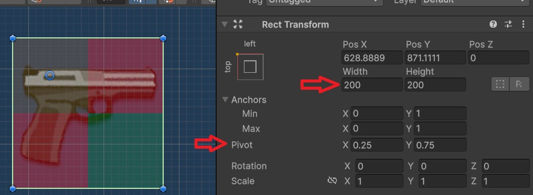
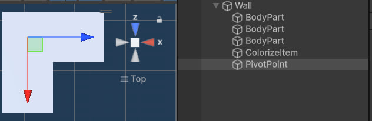

<div align="center">

# "Grid System (2D/3D) by at0m"
#### In process

</div>

### Description
- A Unity plugin for inventories and any other systems that need a grid and irregularly shaped items.
- Version 2 lives in `Assets/GridSystem/New`. The old implementation in `Assets/GridSystem/Examples` is kept as a reference example.
- Technology stack: MessagePipe, UniTask, R3, Unity Input System, PrimeTween or DOTween (optional). DI agnostic core plus one integration package: Zenject, VContainer or Reflex.

### Unity versions
- Unity 6 or higher.

#### Advantages
- 2D (Canvas) and 3D surfaces, items move freely between them (UI <-> World).
- Complex shapes with a pivot cell and 4 precomputed rotations.
- DI agnostic core: one composition description, separate integration packages for Zenject, VContainer and Reflex.
- No allocations in hot paths: flat occupancy matrix, O(1) cell lookup, analytic screen-to-cell conversion (no raycasts), event driven input (no per frame polling), drop handlers re-evaluated only when the target changes, pooled views, struct messages.
- Extensible: drop handlers chain, custom surfaces, views, motions, highlighters, storages, modules.

#### Road Map
- Grid expansion at runtime.
- Addressables item view provider.

## Architecture (v2)

Commands that return a result are called through interfaces (`IInventoryService`, `ISurfaceService`, `ISurfaceLocator`, `IInventoryPersistence`).
Everything that only notifies goes through MessagePipe struct messages. Services do not call each other's views or state.

```
InputSystemPointerInput ──► PointerMoved / PointerButton / RotateRequested
                                         │
             ┌───────────────────────────┴──────────────────────┐
             ▼                                                  ▼
      ItemDragService                                   ItemHoverService ──► ItemHover ──► tooltip
  (state machine, drop handlers,                           
   no views) ──► ItemDragStarted / Updated / Ended
                         │
                         ▼
             GridSurfacePresenter (one per opened surface)
             hides the dragged item, draws preview, animates arrival
                         ▲
GridInventory (Core) ── R3 Added / Removed / Moved ──┘
       │
InventoryService ──► ItemAdded / ItemRemoved / ItemMoved ──► any listener (saves, quests, UI)
SurfaceService   ──► SurfaceOpened / SurfaceClosed      ──► windows, auto save, drag cancel
MergeDropHandler ──► ItemsMerged
```

| Package | Folder | Assemblies |
|---|---|---|
| `com.at0m.gridsystem` (core, DI agnostic) | `New/GridSystem` | `GridSystem.Core`, `GridSystem.Runtime`, `GridSystem.Editor`, `GridSystem.Samples` (not auto referenced) |
| `com.at0m.gridsystem.zenject` | `New/Integrations/Zenject` | `GridSystem.Integrations.Zenject` |
| `com.at0m.gridsystem.vcontainer` | `New/Integrations/VContainer` | `GridSystem.Integrations.VContainer` |
| `com.at0m.gridsystem.reflex` | `New/Integrations/Reflex` | `GridSystem.Integrations.Reflex` |

The core package does not reference any container. Every integration package depends on the core and on its own container only.
A project installs the core and exactly one integration. Namespaces follow folders (`GridSystem.Runtime.Surfaces`, ...).

## Installation

1. Dependencies:
   - [UniTask](https://github.com/Cysharp/UniTask) `https://github.com/Cysharp/UniTask.git?path=src/UniTask/Assets/Plugins/UniTask`
   - [MessagePipe](https://github.com/Cysharp/MessagePipe) `https://github.com/Cysharp/MessagePipe.git?path=src/MessagePipe.Unity/Assets/Plugins/MessagePipe`
   - [R3](https://github.com/Cysharp/R3): `R3` via NuGetForUnity and `https://github.com/Cysharp/R3.git?path=src/R3.Unity/Assets/R3.Unity`
   - Your container: Zenject (Extenject), VContainer or Reflex.
   - Input System and uGUI are resolved automatically.
2. Core: `https://github.com/at0m-gmng/Grid-System-2D-3D-by-at0m.git?path=Assets/GridSystem/New/GridSystem#v2.0.0`
3. One integration:
   - Zenject: `...?path=Assets/GridSystem/New/Integrations/Zenject#v2.0.0`
   - VContainer: `...?path=Assets/GridSystem/New/Integrations/VContainer#v2.0.0`
   - Reflex: `...?path=Assets/GridSystem/New/Integrations/Reflex#v2.0.0`

Install the core before the integration: UPM does not resolve git dependencies, the integration's dependency on `com.at0m.gridsystem` is satisfied by the installed core.

Releases (`.unitypackage`): export `New/GridSystem` + one `New/Integrations/<Container>` folder, three files per version: `GridSystem-Zenject`, `GridSystem-VContainer`, `GridSystem-Reflex`.

### Scripting defines

| Define | Set by | Enables |
|---|---|---|
| `GRID_SYSTEM_PRIMETWEEN` | automatically for `com.kyrylokuzyk.primetween` | `PrimeTweenItemMotion` (allocation free, recommended) |
| `DOTWEEN` | DOTween setup utility | `DOTweenItemMotion` (enable DOTween recycling to avoid allocations) |

Without tweens use `InstantItemMotion`.

### Setup

1. Create assets (`Create/Grid System/...`): `Item Definition` for every item, `Item Definition Catalog`, `Merge Rules`, `Pointer Input Config` (Point: Value/Vector2 pointer position, Press: Button, Rotate: Button), `Settings` referencing them, `Grid Definition` for every grid size, `Item View Catalog` per surface kind (UI, World).
2. Item shape: Width/Height, LMB toggles a cell, RMB sets the pivot cell (placement anchor and rotation center).
3. Item view prefab:
   - UI: root `RectTransform` with `UIItemView`, a body child with the image, `GraphicItemHighlighter`, a motion component. Size and pivot are calculated from the shape.
   - World: root with `WorldItemView`, model child centered on its bounds (1 unit per cell), `RendererItemHighlighter`, a motion component.
4. Surfaces: `UIGridSurface` (grid `RectTransform`, event camera or none for Overlay) or `WorldGridSurface` (transform is the grid center on local XZ, camera). Assign items root, cells root, cell prefab, cell size, spacing, `Item View Catalog`. Overlapping surfaces are picked by `Priority` (UI above World).
5. Scene: `GridSystemContext` (settings, inactive pool root, modules) and one adapter:
   - Zenject: `ZenjectGridInstaller` in SceneContext installers, or `Container.InstallGridSystem(context)`.
   - VContainer: `GridSystemLifetimeScope`, or `builder.InstallGridSystem(context)` in your scope.
   - Reflex: `ReflexGridInstaller` on the scene `ContainerScope` object (or its child), or `builder.InstallGridSystem(context)`.
6. Game code: call `IInventoryService`, `ISurfaceService`, `IInventoryPersistence`, `IGridItemFactory`; listen with `ISubscriber<T>` (all messages are in `GridSystem.Runtime.Messaging`).

### Extension points
- `GridModule` – registers your services through `IGridRegistrar` for every container.
- `IItemDropHandler` – custom drop logic (stacking, swapping, equipment slots); lower `Order` runs first.
- Pointer source – replace `InputSystemPointerInput` with any publisher of pointer messages.
- `ItemDefinition` – inherit to add game data (see `SampleItemDefinition`).
- `IItemDefinitionCatalog`, `IMergeRules`, `ISaveStorage` – data sources (ScriptableObject implementations are provided).
- `GridSurface`, `ItemView`, `ItemMotion`, `ItemHighlighter` – replaceable view building blocks.

<div align="center">

### Download
[](https://github.com/at0m-gmng/Grid-System-2D-3D-by-at0m/releases)

</div>
<div align="center">

### Demo

<div align="center" style="font-size: 40px">
<div style="transform: scale(0.35); transform-origin: top center;">

[](Demo.gif)

</div></div></div>
<div style="text-align: left; margin-top: -120%;">

<div align="center">

# ❓ FAQ

</div>

<div>
<details>
<summary style="font-size: 1.6em; font-weight: bold;"><b>How do I create a new entity?</b></summary>
<p> Create/Inventory/Select the desired data</p>
</details>

<details>
<summary style="font-size: 1.6em; font-weight: bold;"><b>How do I set up ItemData?</b></summary>
<p>
1) Create data in the "Create/Inventory/ItemData" path.<br>
2) In the created ItemData, configure Rows and Columns as if your item were rectangular.<br>
3) CellSize is designed for convenience and allows you to customize the visual size.<br>
The location of an element in the table is configured by configuring the position matrix in EditorGrid.<br>
Since our matrix is rectangular, complex objects will have empty cells in addition to the center and occupied cells. This is normal and intended.<br>
<div align="center"></div>
4) Next, configure the pivot and dimensions of the object. Also, arrange the element as it is in the EditorGrid.<br>
<div align="center"></div><br>
5) For 3D objects, you will need to create a child Transform to implement pivot.<br>
<div align="center"></div><br>
6) Next, you need to add your ItemData to InventoryConfig. For 2D and 3D items, they are different, so be careful.
</p>
</details>

<details>
<summary style="font-size: 1.6em; font-weight: bold;"><b>How do I create a new Grid?</b></summary>
<p> 
1) Create an InventoryConfig and configure its dimensions and cell prefab.<br>
2) Now you need to add your new Grid to InventoriesConfig and assign it the desired type.
</p>
</details>

</div></div>